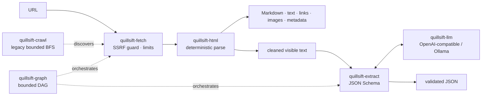

<div align="center">

# QuillSift

**Self-hosted web scraping for AI, written in Rust.**

Deterministic HTML → Markdown, text, links and JSON by default.
Optional schema-validated LLM extraction with OpenAI-compatible APIs or Ollama.
No browser. No paid scraping API. No vendor lock-in.

[](https://github.com/Mullassery/QuillSift/actions/workflows/ci.yml)
[](https://pypi.org/project/quillsift/)
[](https://pypi.org/project/quillsift/)
[](./LICENSE)
[](https://www.rust-lang.org/)

[Python](#python) · [CLI](#cli) · [How it works](#how-it-works) · [Security](#security) · [Status](#status-and-roadmap) · [Contributing](#contributing)

</div>

---

> **Status: alpha.** Deterministic fetch/parse, the bounded graph executor, LLM
> extraction, the `quillsift` CLI and PyPI Python bindings are implemented and
> tested. The built-in crawler is a legacy compatibility fallback; new crawling
> and JavaScript-rendering work belongs in [MudFish](https://github.com/Mullassery/MudFish).
> Search providers, a REST API and an MCP server are on the roadmap. Nothing
> here is a claim of production readiness.

> **Renamed:** QuillSift was previously published as ScrapeOwl. The former name
> conflicted with an existing commercial scraping API; the `scrapeowl` package
> is superseded by `quillsift`. `scrapeowl` 0.2.3 is a deprecation shim that
> re-exports `quillsift` and emits an import warning.

## Why QuillSift

Most scraping stacks force a trade-off: use a browser and pay the CPU/RAM bill,
send every URL to a hosted API, or hand-roll HTML parsing and SSRF protection.

QuillSift takes a different path:

- **Deterministic first.** Fetch, parse and extract clean content with no LLM,
  no browser, no credentials and no per-request cost.
- **Typed and bounded.** The graph engine has explicit deadlines, cancellation,
  retries, concurrency limits and failure isolation. The legacy crawler retains
  page, depth, concurrency and politeness limits; MudFish is the supported path
  for new crawling work.
- **Secure by default.** Private and loopback destinations are refused unless
  you explicitly opt in. Redirects, response size and time are capped. Downloaded
  content is never executed.
- **LLM optional.** When you do want structured data, send the cleaned visible
  text to an OpenAI-compatible endpoint or a local Ollama model, and validate the
  result against a JSON Schema with bounded repair.
- **Rust + Python.** A single guarded engine is exposed through a CLI and PyO3
  bindings. Blocking Python calls release the GIL.

## Install

Python 3.9+:

```bash
pip install quillsift
```

CLI from source (Rust stable):

```bash
git clone https://github.com/Mullassery/QuillSift.git
cd QuillSift
cargo install --path crates/quillsift-cli
```

## Quick start

### Python

```python
import quillsift

# Deterministic path: no LLM, no API key.
markdown = quillsift.fetch("https://example.com")
page = quillsift.fetch("https://example.com", format="json")

print(markdown)
print(page["metadata"]["title"])
print(page["links"][:3])
```

`format` accepts `"markdown"`, `"text"` or `"json"`. The JSON form returns
`url`, `text`, `markdown`, `links`, `images` and `metadata`.

### Bounded crawl (legacy)

QuillSift's built-in crawler remains for API and CLI compatibility with bug
fixes only. For new crawling, politeness controls, resumable state or
headless-Chrome rendering, use **MudFish** instead of adding crawl features
here.

```python
import quillsift

report = quillsift.crawl(
    "https://example.com",
    max_depth=2,
    max_pages=25,
    same_origin=True,
    respect_robots=True,
    crawl_delay_ms=250,
)
for page in report["pages"]:
    print(page["url"], page["content"]["metadata"]["title"])
```

The crawler is breadth-first and deduplicates URLs. Per-page failures are
returned in `report["failures"]`; they do not abort the job. `report["truncated"]`
is true when a page limit stopped discovery.

### Crawling and rendering with MudFish

MudFish is the supported crawler and optional browser-rendering layer:

```bash
pip install mudfish
```

```python
import mudfish

result = mudfish.crawl(
    "https://example.com",
    depth=2,
    max_urls=25,
    render_js=False,  # opt in to headless Chrome only when needed
)
for page in result:
    print(page.status_code, page.url, page.title)
```

Use MudFish to discover URLs and crawl safely, then use QuillSift's `fetch` or
`extract` for clean content and schema-validated structured extraction. QuillSift
itself still does not execute JavaScript.

### Structured extraction with a JSON Schema

```python
import quillsift

schema = {
    "type": "object",
    "required": ["title", "summary"],
    "properties": {
        "title": {"type": "string"},
        "summary": {"type": "string"},
        "topics": {"type": "array", "items": {"type": "string"}},
    },
}

result = quillsift.extract(
    "https://example.com",
    schema,
    model="gpt-4o-mini",  # reads OPENAI_API_KEY
)
print(result["title"], result["topics"])
```

Local models never need a paid key:

```python
result = quillsift.extract(
    "https://example.com",
    schema,
    provider="ollama",
    base_url="http://localhost:11434",
    model="llama3",
    allow_private=True,  # loopback requires an explicit opt-in
)
```

### CLI

```bash
# Deterministic path: no LLM, no credentials.
quillsift fetch https://example.com --format markdown

# Legacy bounded crawl: same-origin by default, robots.txt honored.
# Prefer MudFish for new crawling and JS-rendered pages.
quillsift crawl https://example.com --max-depth 2 --max-pages 25 --format json

# Schema-validated extraction. The key comes from the environment, never argv.
OPENAI_API_KEY=... quillsift extract https://example.com \
  --schema schema.json --model gpt-4o-mini

# Local Ollama.
quillsift extract http://localhost:8080/ \
  --provider ollama --base-url http://localhost:11434 \
  --model llama3 --schema schema.json --allow-private
```

Extraction receives the deterministic visible text, not raw HTML. The output must
parse as JSON and validate against the supplied schema. The system policy is
fixed; document content is fenced and cannot change it.

## What you get

| Capability | Details |
| --- | --- |
| Deterministic extraction | Title and metadata, visible text, Markdown, links and images |
| Guarded fetching | SSRF address classification, redirect limits, response-size caps, timeouts, rustls |
| Legacy crawling | Breadth-first fallback with depth/page/concurrency caps, `robots.txt`, delay and deduplication; new crawl work belongs in MudFish |
| Graph execution | Typed DAG, bounded concurrency, deadlines, cancellation, retries, failure isolation |
| LLM extraction | OpenAI-compatible `/chat/completions` and Ollama `/api/chat`; no provider lock-in |
| Schema validation | JSON Schema validation with a bounded repair budget and explicit errors |
| Interfaces | `quillsift` CLI and `quillsift` Python package (PyO3, GIL released) |
| Foundations | Rust workspace, `#![forbid(unsafe_code)]` core crates, Apache-2.0 |

## How it works



The workspace is intentionally split so the deterministic path stays small:

| Crate | Responsibility |
| --- | --- |
| `quillsift-core` | Types, errors, fetch/retry/crawl policies, SSRF address classes |
| `quillsift-fetch` | Guarded HTTP client with redirect, size and timeout limits |
| `quillsift-html` | Metadata, text, Markdown, links and images |
| `quillsift-crawl` | Legacy bounded breadth-first crawler kept for compatibility; MudFish owns new crawl/browser work |
| `quillsift-graph` | Bounded DAG executor with deadlines, cancellation and retries |
| `quillsift-llm` | OpenAI-compatible and Ollama chat adapters |
| `quillsift-extract` | Schema-validated extraction with bounded repair |
| `quillsift-cli` | The `quillsift` binary |
| `quillsift-python` | PyO3 bindings published as `quillsift` on PyPI |

## Security

Scraping arbitrary URLs is an SSRF problem before it is a parsing problem.
QuillSift treats it that way:

- Private, loopback and link-local destinations are **denied by default**.
  `allow_private=True` / `--allow-private` is an explicit, documented opt-in for
  trusted deployments and local model endpoints.
- Redirects, response-body size and wall-clock time are bounded.
- HTML is parsed as data. No JavaScript is executed and no downloaded content is
  run.
- Provider credentials are read from environment variables or headers, never
  embedded in URLs or accepted as CLI arguments.
- Extraction input is deterministic visible text. The system prompt is fixed,
  document text is fenced, and output must validate against your schema.

The threat model and planned mitigations are documented in
[`docs/SECURITY_THREAT_MODEL.md`](./docs/SECURITY_THREAT_MODEL.md).

## When QuillSift is the right fit

| You need | QuillSift today |
| --- | --- |
| Clean content without a headless browser | Yes |
| SSRF-safe fetching with hard limits | Yes |
| Local or hosted LLM extraction into a schema | Yes |
| A CLI or Python package over one engine | Yes |
| Bounded, same-origin, robots-aware crawling | Legacy fallback; MudFish preferred |
| Search-provider fan-out | Roadmap |
| JavaScript-rendered pages | Use MudFish `render_js`; not built into QuillSift |
| REST API or MCP server | Roadmap |

## Status and roadmap

- [x] **M0** — Rust workspace, core types, CI
- [x] **M1** — deterministic fetch and HTML extraction
- [x] **M2** — typed, bounded DAG execution engine
- [x] **M3** — LLM extraction, CLI and Python wheel
- [x] **M4a** — bounded crawl (legacy fallback; compatibility fixes only)
- [ ] **M4b** — pluggable search providers
- [ ] **M5** — superseded by MudFish; no browser engine planned in QuillSift
- [ ] **M6** — REST API and MCP server
- [ ] **M7** — hardening and benchmarks
- [ ] **M8** — documentation and release

Design details and acceptance criteria live in
[`docs/RUST_ARCHITECTURE.md`](./docs/RUST_ARCHITECTURE.md); feature goals are
tracked in [`docs/FEATURE_PARITY_MATRIX.md`](./docs/FEATURE_PARITY_MATRIX.md).

## Development

```bash
cargo test --workspace
cargo clippy --workspace --all-targets --all-features -- -D warnings
cargo fmt --all -- --check
cargo deny check
cargo audit
```

Python wheel smoke test:

```bash
cd crates/quillsift-python
maturin build --release --out dist
pip install dist/*.whl
python tests/smoke.py
```

## Contributing

Issues and pull requests are welcome. Good starting points:

- New deterministic extractors (tables, feeds, JSON-LD, readability heuristics)
- More provider adapters behind the existing `quillsift-llm` interface
- Fuzz/property tests for the HTML and URL parsers
- Documentation, examples and benchmarks

If QuillSift saves you a browser or a paid API call, **star the repo** — it helps
other people find it.

## License and attribution

Apache-2.0 — see [`LICENSE`](./LICENSE).

QuillSift is an independent, clean-room implementation inspired by the public API
concepts of [ScrapeGraphAI](https://github.com/ScrapeGraphAI/Scrapegraph-ai). It
is **not affiliated with, endorsed by, or derived from** the ScrapeGraphAI source
code. Upstream attribution is recorded in [`NOTICE.md`](./NOTICE.md).
